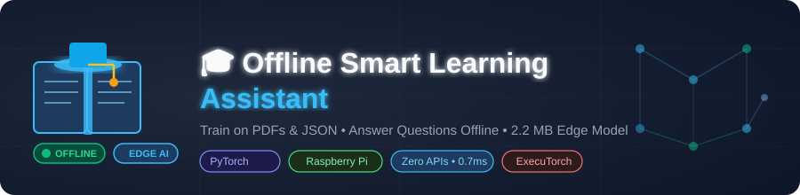

<p align="center">
  
</p>

<p align="center">
  
</p>

<h1 align="center">AI for Inclusive Education: Offline Smart Learning Assistant</h1>

<p align="center">
  <a href="https://pytorch.org/"></a>
  
  <a href="https://ai-inclusive-education-offline-assi.vercel.app"></a>
</p>
<p align="center">
  
  
  
  
  
</p>

<p align="center">
  🌐 <b>Live Hosted Web App (conversational only):</b> <a href="https://ai-inclusive-education-offline-assi.vercel.app"><b>https://ai-inclusive-education-offline-assi.vercel.app</b></a>
</p>

> **Note:** The Vercel hosted demo supports conversational chat only. PDF-based Q&A with citations requires running the app locally with PyTorch installed (see Quick Start below).

---

[](https://pytorch.org/)
[]()
[-brightgreen.svg)]()
[]()
[]()
[](./LICENSE)

An offline Edge AI learning companion that allows educators and students in low-connectivity regions to:
1. **Train directly on text-based PDF textbooks and notes** using native PyTorch offline backpropagation.
2. **Compress the trained model into a `.pth` file** (low memory footprint, fast edge loading, ~2–4 MB).
3. **Answer student questions with evidence-based retrieval** — answers cite the exact page and excerpt from the uploaded PDF, and explicitly say "not found" when the topic is not covered.
4. **Generate diagnostic learning aids** (3-point summaries and 3 quiz questions).

> **Scanned PDFs:** This app works with text-based PDFs only. For scanned / image-only PDFs, run OCR first: `ocrmypdf input.pdf output.pdf`

### Upload-to-Offline-Knowledge Workflow

When a PDF is uploaded through the local GUI, the application now:

1. Extracts all selectable page text and stores it in `data/converted_text/`.
2. Preserves page references and creates grounded `what`, `how`, `when`, `where`, `who`, and `why` questions when the source text contains the required evidence.
3. Stores each answer as source text from the PDF rather than inventing an answer.
4. Trains the local PyTorch retrieval model from the generated JSON archive.
5. Loads the resulting `.pth` checkpoint for offline questions and page citations.

This is an offline retrieval-and-extractive-synthesis system, not a cloud LLM. It cannot recover text from image-only PDFs without OCR, and generated questions are limited to facts that can be detected in the extracted text.

## 🌐 Host the Project

GitHub stores the source code; it does not run the Python/PyTorch application. Use Vercel for the hosted web demo, or run the full offline application locally.

### Push the project to GitHub

The repository is already configured with the `origin` remote. From the project folder:

```bash
git add .
git commit -m "Update offline PDF knowledge pipeline"
git push origin main
```

If the branch is not named `main`, check it with `git branch --show-current` and replace `main` in the push command.

### Deploy the hosted demo with Vercel

Install and authenticate with Vercel once:

```bash
npm install -g vercel
vercel login
```

Deploy from the repository root:

```bash
vercel --prod
```

The Vercel deployment is a hosted demo. It is not the same as local offline mode, and PDF training requires a local environment with PyTorch installed.

### Run the complete offline application locally

```bash
./venv/bin/python gui.py
```

Then open `http://127.0.0.1:8000`. Uploading a text-based PDF creates a JSON knowledge archive, generates grounded questions and answers, and trains the local model without cloud APIs.

### Train from a PDF folder

Put one or more PDFs into [`pdfs_to_train/`](./pdfs_to_train), then run:

```bash
./venv/bin/python train_and_qa.py convert-pdfs
./venv/bin/python train_and_qa.py train-from-folders
```

The first command creates one JSON file per PDF under [`data/converted_json/`](./data/converted_json), preserving subject folders. Each JSON contains extraction metadata, page/chunk text, and grounded typed Q&A pairs. The second command runs this conversion automatically and trains only from those generated JSON files. The GUI's folder-training button performs both steps.

Question wording is configured in [`data/question_patterns/`](./data/question_patterns/).
It contains subject-specific patterns for English, science, mathematics, social
science, and general learning. The converter detects the subject folder, uses
the matching patterns, and keeps every answer grounded in the source text.

Topic extraction uses the local spaCy `en_core_web_sm` model when installed. This
selects noun phrases instead of relying only on the first remaining word. Install
the dependency and model once while online; question generation then runs fully
offline:

```bash
./venv/bin/pip install -r requirements.txt
./venv/bin/python -m spacy download en_core_web_sm
```

If the model is unavailable, the converter uses its built-in deterministic
heuristic fallback and continues without a network request.

The converter also uses local PyMuPDF and Tesseract OCR to detect large,
stylized opening-page text such as chapter titles and author names. These are
stored as `document_metadata` in the JSON archive. Install the Python packages
and the local Tesseract executable once:

```bash
./venv/bin/pip install -r requirements.txt
brew install tesseract
```

The 1,000 question patterns control question wording; they cannot recover
letters that the PDF text layer does not contain. OCR and layout-aware
extraction solve that recognition problem without requiring an online AI API.

---

## 🌟 Key Capabilities

### 1. Train Purely on PDFs (No Questions Needed, No APIs)
- **Automatic Question Synthesis**: Ingests raw chapter text, extracts definitions, mechanisms, and roles, and automatically generates diverse curriculum training pairs.
- **PDF & JSON Ingestion**: Ingests standard text-based PDF textbooks or optional JSON Q&A pairs.
- **Local Training**: Uses an attention-based Transformer model (`EdgeNeuralQAModel`) with InfoNCE contrastive representation learning.
- **Compressed `.pth` File**: Packages model weights, vocabulary, and indexed knowledge embeddings into a compressed PyTorch checkpoint (`.pth`), typically **~2–4 MB** for edge deployments.
- **PDF Extraction Report**: Prints a diagnostic report for every PDF — pages with text, blank pages, and a clear warning if the PDF appears scanned.

### 2. Evidence-Based Offline Question Answering
- **Retrieval with Citations**: Retrieves the best matching passages from your uploaded PDF and cites the exact page/section.
- **Honest Confidence**: Confidence scores reflect actual retrieval quality and are not inflated. Low-confidence or off-topic questions return an explicit "not found" response instead of a fabricated answer.
- **Fast Local Inference**: Typical latency is under 5 ms on a modern CPU; actual numbers vary by hardware.
- **Separate Document & Conversation Knowledge**: PDF curriculum answers and daily conversation answers are drawn from separate collections to avoid cross-contamination.

---

## 🚀 Quick Start: Train & Answer (PyTorch `.pth` Model)

### 1. Run Automated End-to-End Demo
Creates sample science textbook (PDF) and curriculum Q&A (JSON), trains the neural model from scratch, saves `demo_curriculum_model.pth`, and queries it:
```bash
python3 train_and_qa.py demo
```

### 2. Train on Your Own PDF Textbooks and JSON Files
```bash
python3 train_and_qa.py train \
    --pdf path/to/textbook.pdf \
    --json path/to/curriculum_qa.json \
    --epochs 15 \
    --save models/my_curriculum_model.pth
```

### 3. Ask Questions Offline
```bash
python3 train_and_qa.py ask \
    --model models/my_curriculum_model.pth \
    --question "What is the function of stomata in plant leaves?"
```

Sample output:
```text
====================================================================
  Question: What is the function of stomata in plant leaves?
--------------------------------------------------------------------
  Answer:   Stomata are microscopic pores in leaves that regulate the intake of carbon dioxide and release of oxygen.

  Source:   curriculum_qa.json (Entry #2)
  Excerpt:  "Stomata on the underside of plant leaves facilitate gas exchange necessary for photosynthesis...."
--------------------------------------------------------------------
  Confidence: 87.3% | Latency: <5 ms (CPU) | Offline: 100%
====================================================================
```

### 4. Interactive Terminal Q&A Mode
Chat with your trained model offline in real time:
```bash
./venv/bin/python3 train_and_qa.py interactive --model models/demo_curriculum_model.pth
```

---

## 🖥️ Lightweight Graphical User Interface (GUI)

The application includes two lightweight GUI options with **zero external GUI dependencies**:

### Option A: Modern Lightweight Web GUI (Default)
Runs a local zero-dependency server (`http.server`) and opens directly in your browser:
```bash
./venv/bin/python3 gui.py
```
- **Input to Output workflow**:
  - **Ask Questions Tab**: Preset query pills, instant input, answer card with source page citation, confidence score (%), and latency.
  - **Train Model Tab**: Select local PDF and JSON files, adjust epochs, view real-time training metrics and compressed `.pth` size.
  - **Study Aid Tab**: Ingest any 150–300 word passage and generate structured summaries + 3 quiz questions.

### Option B: Native Desktop Window (Tkinter)
Launches a standalone native desktop window on macOS, Linux, or Raspberry Pi:
```bash
./venv/bin/python3 gui.py --desktop
```

---

## 🎯 Hackathon Deliverables (Problem Statement 1)

For the organizer-provided passage summary & quiz generation task:

```bash
# Run on curated sample passages
python3 -m tools.assistant --sample 1   # Biology (Photosynthesis)
python3 -m tools.assistant --sample 2   # Physics (Renewable Energy)
python3 -m tools.assistant --sample 3   # Earth Science (Water Cycle)

# Run batch benchmark
python3 -m tools.assistant --benchmark
```

See [`docs/IMPACT_REPORT.md`](./docs/IMPACT_REPORT.md) for the complete evaluation report and [`docs/PI_SETUP.md`](./docs/PI_SETUP.md) for the Raspberry Pi setup guide.

---

## 📁 Repository Structure

```
├── train_and_qa.py            # Primary CLI: Train on PDF/JSON & Answer offline
├── trainer.py                 # PyTorch training loop, InfoNCE loss, .pth compressor
├── model.py                   # EdgeNeuralQAModel (Transformer + Dual Semantic Heads)
├── qa_engine.py               # Local Q&A engine with Hybrid Reciprocal Rank Fusion
├── data_loader.py             # PDF (pypdf) & JSON curriculum parser + Vocabulary
├── pdf_to_json.py             # Converts PDF folders into structured JSON archives
├── run.sh                     # One-command launcher for GUI, conversion, training, and Q&A
├── metrics.py                 # Telemetry (RAM RSS, latency, tok/s, 0 network calls)
├── prompt_templates.py        # Structured prompt formatters & passage validator
├── tools/                     # Optional assistant, sample-data, desktop-GUI, and export utilities
├── docs/                      # Impact report and Raspberry Pi setup guide
└── sample_data/               # Sample educational PDF and JSON datasets
```

---

## ▶️ Run Commands

```bash
# Start the local web GUI
./run.sh gui

# Convert all PDFs to JSON
./run.sh convert

# Extract all PDFs to page-preserving text files
./run.sh text

# Convert PDFs and train the offline model
./run.sh train

# Ask the trained model
./run.sh ask --model data/trained_models/folder_trained_model.pth --question "What is the main topic?"
```

The `text`, `convert`, and `train` commands open a local progress window while
they work. The window shows the percentage completed, the current PDF or
training epoch, live output, and completion or failure status. For `train`, PDF
conversion represents the first half and model training represents the second
half of the overall percentage. Processing remains fully offline.

Generated files are separated into these folders:

- `data/converted_text/` — page-preserving `.txt` files
- `data/converted_json/` — structured `.json` archives
- `data/trained_models/` — trained `.pth` model files
- `data/generated_questions/` — generated questions grouped by subject
- `data/generated_answers/` — generated answers grouped by subject

Text files preserve the subject and filename structure from `pdfs_to_train/`.
The JSON converter reads this TXT folder explicitly. Each page is separated by
`===== PAGE N =====`. Run `./run.sh text` first; `./run.sh convert` then reads
only these `.txt` files and stores their paths in the generated JSON archives.
It does not extract text directly from PDFs, and reports an error if a matching
text file is missing.

---

## 📄 License
This project is licensed under the MIT License - see [LICENSE](./LICENSE) for details.
